# slink-bridge

A web interface for my Sony STR-DB930 home theater receiver that runs on an ESP32. It communicates over S-Link (on the Control A1 jack). 

The web interface shows power, current input and status, with buttons for inputs, volume, mute, 5.1 and more. 

[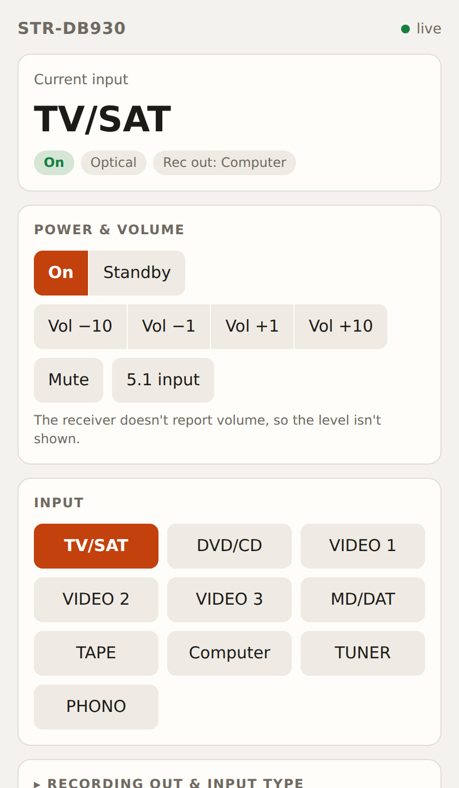](images/web-ui.png)
[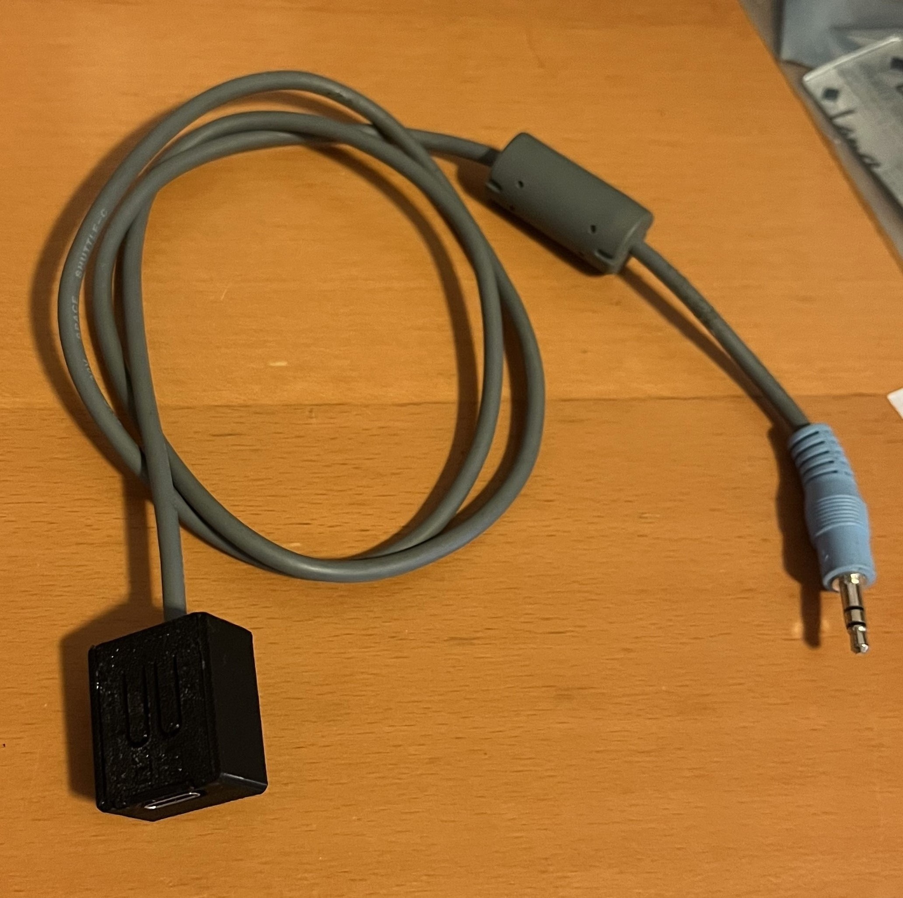](images/assembly-6.jpg)

## Tested on

| Board | Receiver | Pins (TX / RX) |
|---|---|---|
| LOLIN ESP32-S2 Mini v1.0.0 | Sony STR-DB930 | GPIO16 / GPIO18 |
| ESP32-C3 SuperMini | Sony STR-DB930 | GPIO3 / GPIO4 |

## Credits

- [boehmel.de S-Link page](http://web.archive.org/web/20180831072659/http://boehmel.de/slink.htm): the S-Link / Control A1
  command and reply reference. The input codes, status queries, tuner, surround and settings commands all come from here.
- [robho/sony_slink](https://github.com/robho/sony_slink): bus timing (sync, bit and gap lengths) and
  the NPN open-collector transmit circuit, from their Arduino/ESP8266 sketches.
- [Reza's S-Link notes](http://web.archive.org/web/20070720171202/http://www.reza.net/slink/text.txt): background on driving the
  bus through a transistor, linked from robho/sony_slink.

## PCB

The PCB is a simple carrier board that goes on the back of an ESP32-C3 SuperMini. A 1/8" mono jack connects to the receiver.

### Schematic

[](pcb/S-Link%20Bridge%20v1.0%20-%20Schematic.png)

The receiver pulls the bus up to ~5 V. To transmit a pulse, we turn Q1 on, which pulls the bus to ground. 

To receive, the diode lets the bus go low, but blocks the 5 V idle level from making it to the ESP32 which only has 3.3v IO.

The part values are not critical.

### Board

[](pcb/S-Link%20Bridge%20v1.0%20Top.png)

The outline of the board cuts the 0.1" header, resulting in castellations that can be soldered to the SuperMini's 0.1" header.

### Observations After Building

- The sample PCBs were made 1.6mm thick, I would probably go thinner.
- I didn't pay for the castellation option, and the cut header was a little rough but worked just fine.
- The holes to pass the cable through for strain relief didn't work as expected - the cable causes the board not to sit flat. Didn't end up using them.

## Winamp Plugin

This was the ultimate goal of the project - an easy interface to switch between Computer and TV sources.

The plugin adds a small window with buttons to switch between sources.

[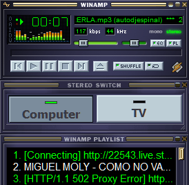](pcb/S-Link%20Bridge%20v1.0%20Top.png)

## Firmware

The ESP32 runs `WebServer.h` which displays a single page with HTML/CSS/JS.

This has been tested with two ESP32 boards, `s2mini` (LOLIN ESP32-S2 Mini) and `c3supermini` (ESP32-C3 SuperMini). The prototype PCBs are meant to work with the SuperMini.

Each board's pins are in `include/board.h`.

The interface is accessible at `http://<ip>`, and `http://slink.local` if mDNS is supported.

### Software Requirements

```
sudo apt install -y pipx
pipx install platformio
pipx ensurepath
sudo usermod -aG dialout $USER # only if flashing over USB from Linux - I used web.esphome.io
```

### Setup

- Copy `include/secrets.h.example` to `include/secrets.h` and `secrets.ini.example` to `secrets.ini`, and fill them in. Make up a secret, and fill your wifi details.
- Run `pio run -e c3supermini` in the `firmware` directory. This writes `firmware/slink-bridge-c3supermini-full.bin` which can be uploaded on web.esphome.io
- Subsequent updates can be sent over wifi: `pio run -e s2mini_ota -t upload --upload-port <ip>`

### Talking to it

```
curl http://slink.local/status
curl 'http://slink.local/log?since=0'
curl -X POST 'http://slink.local/send?hex=c06a'  # ask the amplifier its name
curl 'http://slink.local/debug?on=1'        # log raw pulse widths too
nc slink.local 23                            # live log, type hex to send
```

Log lines are `seq millis RX|TX hex`. `RX` is traffic from the receiver.

### STR-DB930 protocol

See [Credits](#credits) for sources.

Commands go to device `c0`. The receiver answers from `c8` (and `c9`/`cb`).

| Send | Meaning | Reply |
|------|---------|-------|
| `c00f` | query current source | `c870 AA VV ..` (AA audio source, VV video source) |
| `c05004` | select MD/DAT | `c870041601b0`, `cb700b003400` |
| `c05016` | select TV | `c870161601ff`, `cb7001003400` |
| `c06a` | query name | `c86a` + "STR-DB930 " |
| `c02e` / `c02f` | power on / off | `c82e` / `c82f` |

The receiver sends messages unprompted, including on startup, and on every input change (including turning the front panel input knob).
Turning the volume knob is not reported, so we can only drive volume up and down, not to a specific location.

## Case

The case design is based on the [Ultra-Compact Case for ESP32-C3 SuperMini on Thingiverse](https://www.thingiverse.com/thing:7420590). I closed the holes in the base, made the box deeper, and added a cutout for the PCB and wire to enter.


[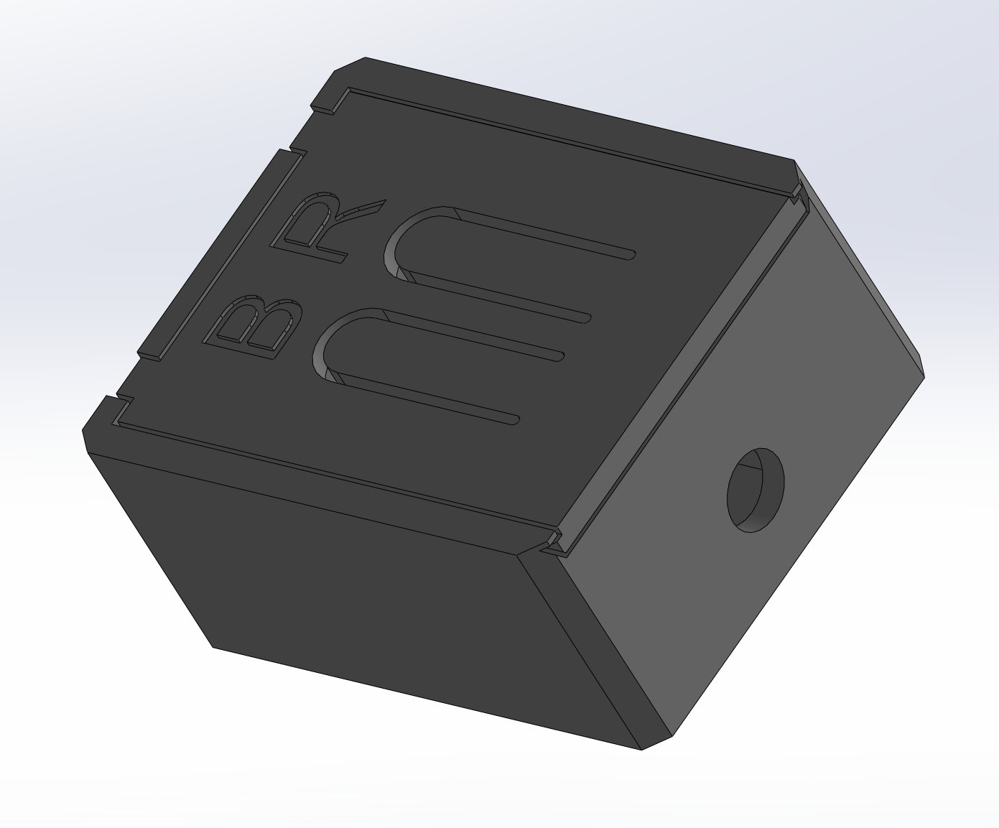](images/case-1.png)
[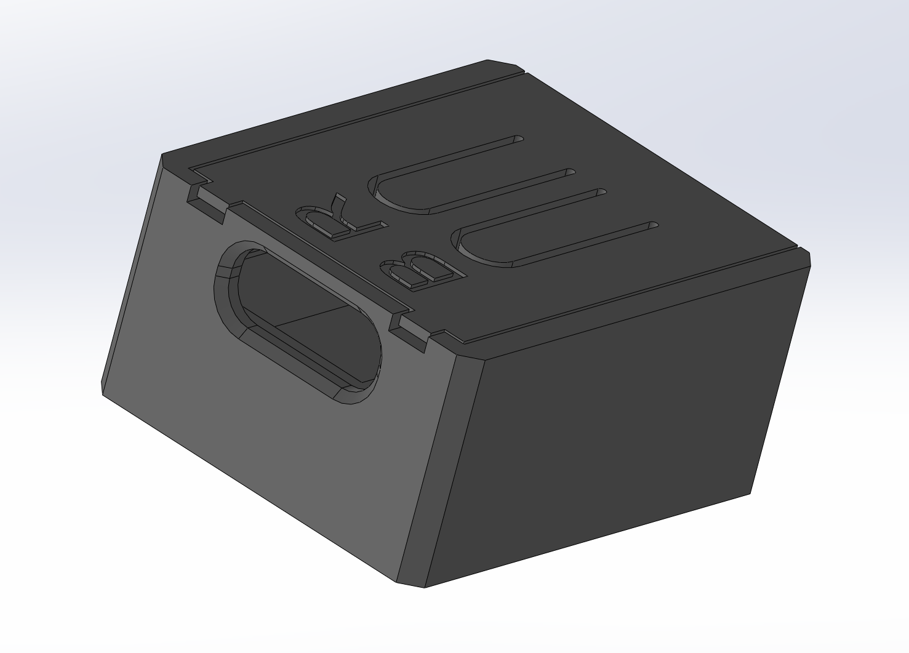](images/case-2.png)
[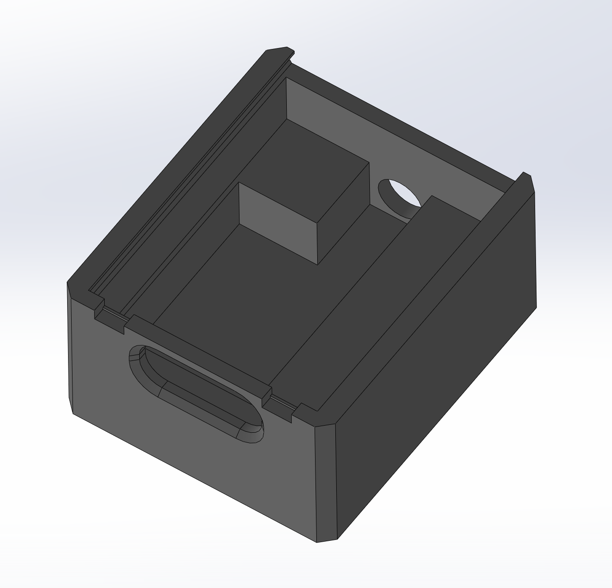](images/case-no-top.png)

## Assembly Photos

#### Soldering the components
[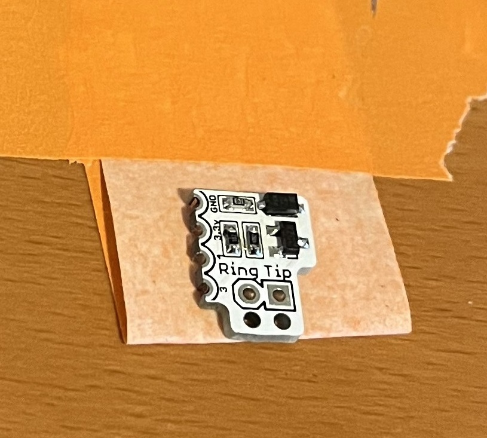](images/assembly-1.jpg)

#### Ready to be assembled
[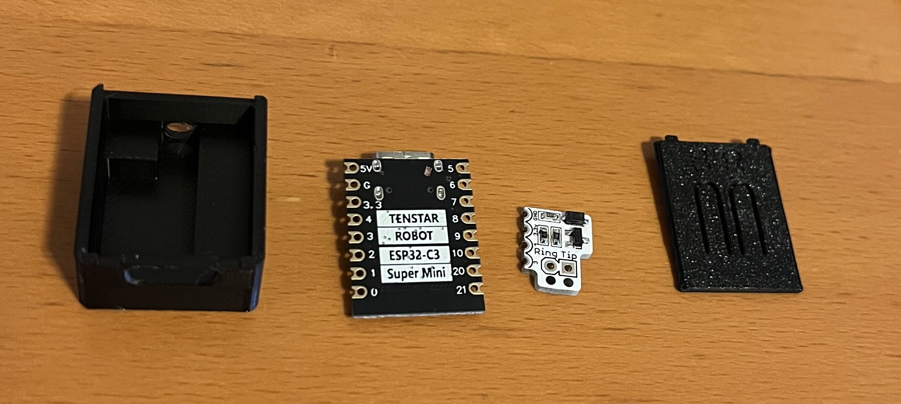](images/assembly-2.jpg)

#### Cable soldered
[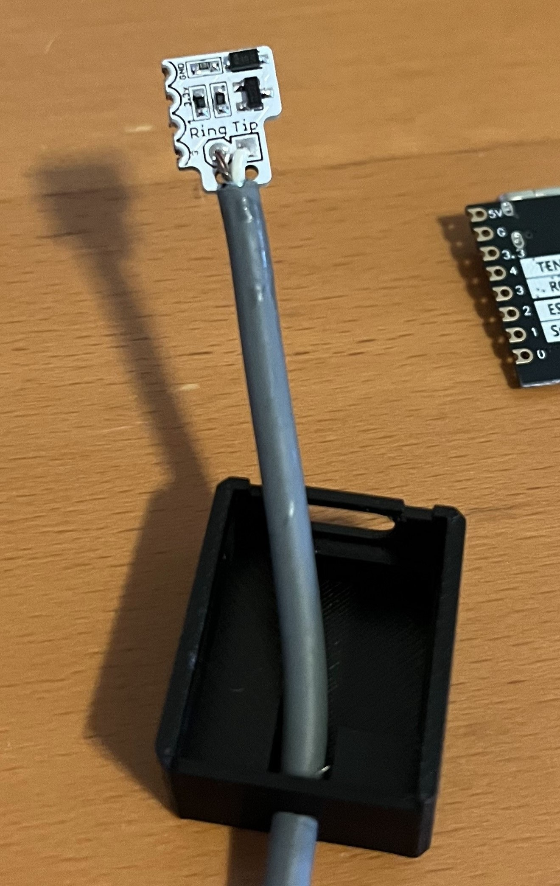](images/assembly-3.jpg)

#### Board soldered to ESP32
[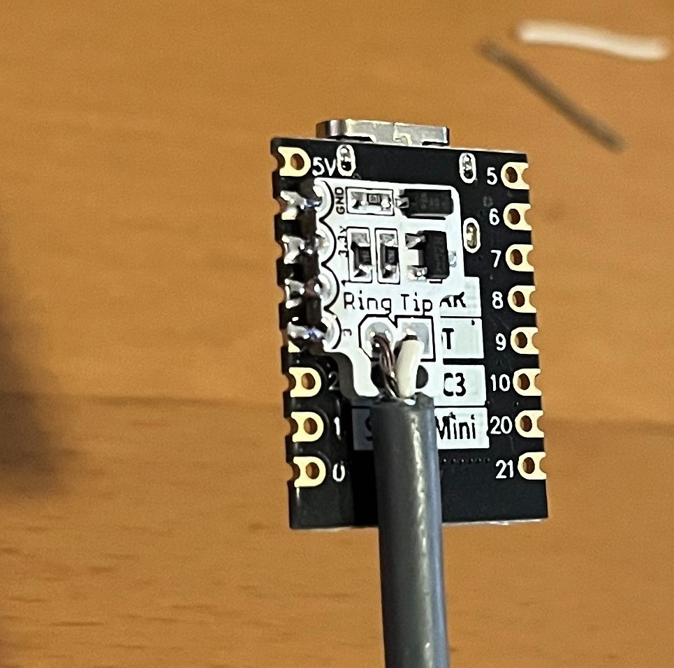](images/assembly-4.jpg)

#### Board installed in case
[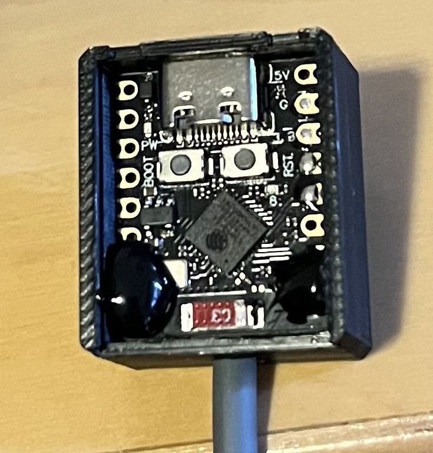](images/assembly-5.jpg)

#### The completed assembly
[](images/assembly-6.jpg)